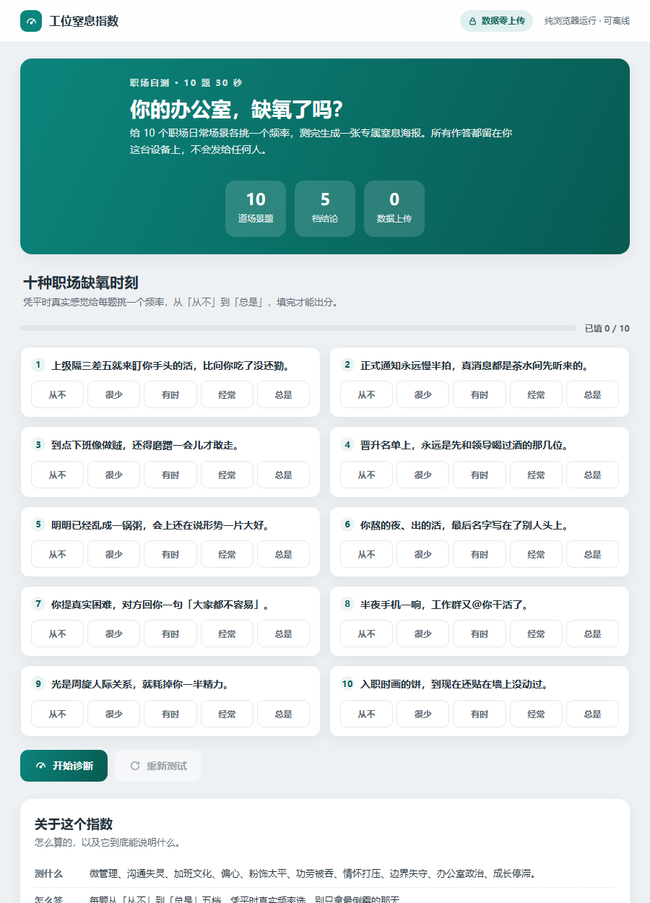

# 工位窒息指数

> 你的办公室，缺氧了吗？

[](./LICENSE) [](./assets/workplace-suffocation-index.html) [](./SKILL.md)

**🔗 [在线体验 →](https://tomatoribs.github.io/workplace-suffocation-index/)**（点开就玩 · 免安装 · 免注册）



一个 47 KB 的单文件 HTML，纯浏览器运行，可离线，手机直接适配。

到点下班像做贼，还得磨蹭一会儿才敢走。
半夜手机一响，工作群又 @你干活了。
入职时画的饼，到现在还贴在墙上没动过。

给 10 个职场日常场景各挑一个发生频率，测完生成一张专属窒息海报。

**10 道场景题 · 5 档结论 · 30 秒 · 0 数据上传**

## 你会测出什么

| 区间 | 档位 |
|---|---|
| 0–20 | 清新职场 |
| 21–40 | 略有异味 |
| 41–60 | 明显缺氧 |
| 61–80 | 高危预警 |
| 81–100 | 毒气室级别 |

## 分数是怎么算的

- 📋 **10 道场景题**——微管理、沟通失灵、加班文化、偏心、粉饰太平、功劳被吞、情怀打压、边界失守、办公室政治、成长停滞，每题都是具体场景，不是空泛情绪
- 🎚 **5 级频率**——从不 / 很少 / 有时 / 经常 / 总是，凭平时真实感觉挑一个
- 📟 **实时指针仪表**——答题时即时联动，只显示分数不出结论，填完才能出分
- 🖼 **专属海报**——9:16 PNG，带编号、日期与一句裂变文案，一键存图转发
- 🔗 **链接分享**——10 个答案编码进链接 hash，打开即还原同一结果，无需服务器
- 🔒 **0 数据上传**——所有答案留在你这台设备上，不会发给任何人

## 效果示例

```text
┌──────────────────────────────┐
│  工位窒息指数                │
│                              │
│         63 / 100             │
│      档位：高危预警          │
│                              │
│  （仪表与结论以页面实际为准）│
└──────────────────────────────┘
```

实际效果见上方首屏截图：十道场景题 + 频率选择 + 顶部实时数字。

## 怎么用

1. 双击 `assets/workplace-suffocation-index.html`（零依赖、可离线，手机可直接打开）。
2. 凭平时真实感觉，给 10 个场景各挑一个频率，约 30 秒。
3. 看档位与点评，存 9:16 海报转发，或复制链接。

## 隐私

纯浏览器运行，可离线。所有答案只留在你这台设备上，不会发给任何人。分享链接只包含你勾选的频率——**转发链接等同于公开你的答案**，请确认后再发。

## 工位生存指南 · 六件套

| 现在的状况 | 玩哪个 | 花多久 |
|---|---|---|
| 只想先给环境做个体检 | **工位窒息指数（你在这）** | 30 秒 |
| 想知道到底有多想走 | [跑路指数测试](https://github.com/TomatoRibs/want-to-quit-index) | 6 分钟 |
| 想知道消耗的源头是谁 | [上司图鉴](https://github.com/TomatoRibs/shangsi-tujian) | 3 分钟 |
| 想给某个同事开庭 | [同事判刑书](https://github.com/TomatoRibs/workplace-verdict) | 3 分钟 |
| 什么也不想干 | [摸鱼签筒](https://github.com/TomatoRibs/moyu-qiantong) | 摇一签 |
| 下午有一场会 | [车祸大会 Bingo](https://github.com/TomatoRibs/huoche-dahui-bingo) | 一场会 |

## 可二创

10 个场景、5 个档位名都在 `assets/workplace-suffocation-index.html` 源码数组里——改成你们团队的「氛围体检」只要几分钟。

## 为什么做这个

「我累不累」这种问题问不出来，因为累本身已经成了正常。给 10 个日常场景各打个分，让指针替你说实话——很多时候缺的不是抗压能力，是氧气。

## 装成 WorkBuddy 技能（可选）

```bash
bash scripts/install_local.sh .
```

WorkBuddy 是一个本地 AI 助手；装成技能后，一句话触发：「做一个 10 题、30 秒出结果的工位窒息测试网页」。

## 免责声明

这是采用通用自评结构（Likert 五级、等权线性归一、分档标签）的**讽刺式自测工具**，命名、题目、文案、视觉与代码均为独立原创。**不是标准化量表，未做信效度检验，不做临床诊断、法律或人力资源取证，也不构成对任何人的评价。** 若需记录真实职场问题，请保留客观事实，并寻求所在地合适的专业或支持渠道。

## 作者 · 许可证

番茄排骨 · [MIT](./LICENSE)

测出来比 63 高？来报个数，顺手点个 Star。

> 先测测缺不缺氧，再决定开不开窗。
